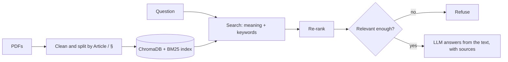

# Contract Sense AI

A question-answering assistant for regulations. You ask something like "When is a DPO required?" and it
answers from the actual text of the GDPR and the German commercial code (HGB), with the sources shown
next to the answer. If a question has nothing to do with those documents, it says so instead of guessing.

I built it to learn how a RAG system works end to end, and to measure how well it works instead of
just trying a few questions by hand.

## What it does

- Reads the GDPR and HGB PDFs and splits them by Article or § so each piece keeps its heading
- Finds relevant text with two kinds of search (meaning-based and keyword-based) and then re-ranks the results
- Works across languages: the GDPR is in English, the HGB is in German, and you can ask in either language
- Refuses questions that are outside the two documents
- Shows the sources for every answer in a Streamlit chat app
- Logs each question to SQLite and each evaluation run to MLflow

## How it works



- Embeddings: `intfloat/multilingual-e5-large`
- Re-ranker: `cross-encoder/mmarco-mMiniLMv2-L12-H384-v1`
- Answers: `openai/gpt-oss-20b` through Groq
- Agent: LangGraph (retrieve, answer, or refuse)
- Vector store: ChromaDB, keyword search with `rank_bm25`
- App: Streamlit

The index has about 2,900 chunks (826 from the GDPR, 2,095 from the HGB). A typical answer takes
5 to 8 seconds on a laptop CPU.

## Evaluation

I wrote 20 test questions (10 GDPR, 10 HGB) and checked every expected answer against the PDF text.
Answers are scored by a second, larger model (`openai/gpt-oss-120b`) on three things:

- **Faithfulness:** is everything in the answer supported by the retrieved text?
- **Context recall:** does the retrieved text contain the facts needed for the right answer?
- **Correctness:** does the answer match the expected answer?

These are modelled on the RAGAs metrics, but I wrote the scoring myself (`evaluation/judge.py`) and
did not use the RAGAs library.

| Run | What changed | Faithfulness | Context recall | Correctness | Real questions refused |
|---|---|---|---|---|---|
| baseline | first measurement | 0.836 | 0.673 | 0.650 | 2 |
| improvement_1 | removed a glossary entry that hid HGB § 252 from the search | 0.947 | 0.723 | 0.675 | 1 |
| improvement_2 | re-measured the relevance threshold, answers in the question's language | 0.992 | 0.757 | 0.700 | 0 |

GDPR questions do well (context recall 0.93, correctness 0.90 in the last run). HGB questions are
weaker (recall 0.58, correctness 0.50).


Scores move by about 0.1 between runs even when the retrieval is identical, so I only trust changes I
can trace to a cause. Two I can: the going-concern question went from refused to answered correctly,
and no real question is refused any more. Faithfulness also needs care. It only checks the answer
against the text that was retrieved, so an answer built from the wrong section can still score 1.0.
That is why I read it together with context recall.

## Problems I ran into

- **"When is a DPO required?" gave an incomplete answer.** I checked each stage of the pipeline and
  found the key paragraph ranked 35th. My text cleaner was deleting every line shorter than 10
  characters, which removed all 99 "Article N" headings, and fixed-size chunks had separated each
  article's heading from its content. I changed the chunking to follow the Article structure and
  put the heading in every chunk. I also expand abbreviations like DPO in the question and add
  the neighbouring chunks of the best results.
- **The HGB was never indexed.** Only the GDPR had been loaded, and the filename was hardcoded.
- **The first re-ranker only understood English,** so it matched language instead of meaning. I
  switched to a multilingual one.
- **Half of my HGB test answers were wrong.** 5 of the 10 expected answers did not match the source
  text. I rewrote them from the PDF.
- **An abbreviation rule I added for "HGB" hid § 252 from the search** for several questions, so I
  removed it.
- **My relevance threshold refused a real question.** I measured it again on all test questions
  (real ones scored -1.08 or higher, most off-topic ones -3.95 or lower) and set it to -2.5.
  Borderline off-topic questions are caught by an instruction in the prompt.
- **Two ideas that did not help:** translating the question into German, and combining the English
  and German ranking scores. I dropped both.

## Limitations

- Three of the 20 test questions still fail: the deadline for annual financial statements (the HGB has
  different deadlines for different kinds of companies and the question does not say which), the
  principle of prudence (§ 252 is outranked by special-case sections), and the consistency principle
  (the answer cites § 265, my expected answer covers § 252, and both rules exist).
- 20 questions is a small test set.
- Answers can be incomplete or wrong. This is a technical project, not legal advice.

## Setup

You need Python 3.11 and a free [Groq](https://console.groq.com) API key. These commands are for
Windows PowerShell.

```powershell
git clone https://github.com/shwetanadge/contract-sense-ai
cd contract-sense-ai
python -m venv venv
venv\Scripts\activate
python -m pip install -r requirements.txt
```

Create a file called `.env` in the project folder with your key (do not commit it):

```
GROQ_API_KEY=your_key_here
```

Groq renames and retires models from time to time. If you get a "model does not exist" error, check which
models your key can use and update the model names in `src/analysis/rag_agent.py` and `evaluation/judge.py`.

Build the index. The first run downloads about 2.7 GB of models and takes 20 to 30 minutes on a CPU:

```powershell
python ingest_all.py
```

Start the app:

```powershell
python -m streamlit run src/app.py
```

Run the evaluation and look at the runs (in MLflow, switch to "Model training" and open the
`compliance-rag-p1` experiment):

```powershell
python evaluation/run_eval.py my_run_name
mlflow ui
```

Run a retrieval check (no API key needed):

```powershell
python -m scripts.test_dpo
```

## Project structure

```
src/
  ingestion/   PDF reading, cleaning and chunking
  retrieval/   embeddings, search, re-ranker
  analysis/    the LangGraph agent
  storage/     SQLite logging
  app.py       Streamlit app
evaluation/    test questions, scoring, results for each run
scripts/       small scripts I used to debug retrieval
data/sample_contracts/   the GDPR and HGB PDFs
ingest_all.py  builds the index
```

## Data

The GDPR is Regulation (EU) 2016/679. The HGB text comes from gesetze-im-internet.de, a service of the
German Federal Ministry of Justice. Both are public legal texts.